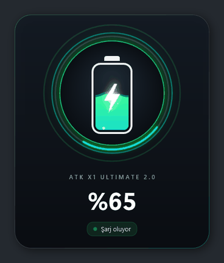
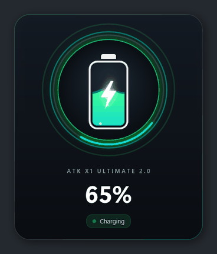
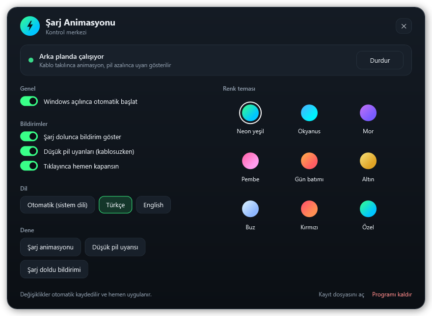
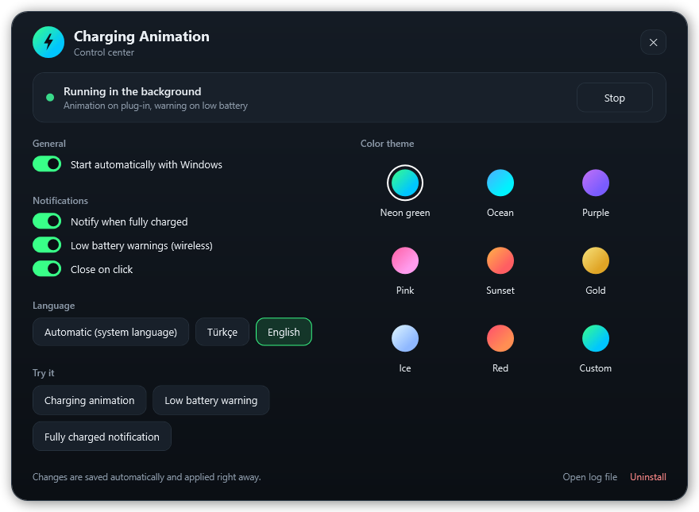

# ATK Charge Animation — ATK mouse şarj animasyonu ve pil bildirimleri

[Türkçe](#türkçe) · [English](#english)

<p align="center">
  
  
</p>

<p align="center">
  
  
</p>

---

## Türkçe

ATK mouse'unuzu USB-C kabloyla şarja taktığınızda ekranda şık bir şarj animasyonu gösteren, pil azalınca ve şarj dolunca da bildirim veren küçük bir Windows aracı. Pil yüzdesi **mouse'un kendisinden** okunur. **ATK HUB'ın yüklü olması gerekmez.**

### Özellikler

- **Şarj animasyonu:** Kablo takıldığı anda açılır, gerçek pil yüzdesini ve modelin adını gösterir. Mouse takıldıktan sonra değeri güncellerse animasyon da canlı olarak güncellenir.
- **Düşük pil uyarısı:** Kablosuz kullanırken pil **%20, %10 ve %5**'e düşünce sağ altta 5 saniyelik kırmızı uyarı balonu.
- **Şarj tamamlandı bildirimi:** Kabloda şarj olurken %100'e ulaşınca, seçtiğiniz temanın renginde bildirim.
- **Renk temaları:** Neon yeşil, Okyanus, Mor, Pembe, Gün batımı, Altın, Buz, Kırmızı ya da kendi iki renginiz.
- **Tek kontrol merkezi:** Başlat / durdur, Windows açılınca başlatma, tema, bildirimler, dil, tek tıkla deneme ve kaldırma; hepsi tek pencereden. Değişiklikler anında uygulanır.
- Odağı çalmaz (oyun oynarken / yazarken klavyeniz kesilmez), tıklayınca kapanır.
- Türkçe / İngilizce.
- Kurulum gerektirmez: Windows'ta hazır gelen PowerShell 5.1 ve .NET ile çalışır.

<p align="center">
  
</p>

### Kurulum

1. Bu repoyu indirin (**Code → Download ZIP**) ve istediğiniz bir klasöre çıkarın.
2. **`ATK Charge Animation.vbs`** dosyasına çift tıklayın. Hepsi bu.

İlk açılışta program arka planda çalışmaya başlar ve Windows açılınca otomatik başlamak üzere ayarlanır; kontrol merkezi açılır. Windows ilk seferde "Yayımcı doğrulanamadı" uyarısı gösterirse **Çalıştır**'a basın (program indirilen dosyalardaki bu engeli kendisi kaldırır, bir daha sormaz).

Kaldırmak için kontrol merkezinde **Programı kaldır**'a basın, ardından klasörü silin.

```
ATK Charge Animation/
├── ATK Charge Animation.vbs   ← çalıştırılacak tek dosya
├── README.md, LICENSE
└── app/                       ← programın geri kalanı
```

### Desteklenen mouse'lar

ATK HUB'ın tanıdığı **251 ATK / VXE / MAD cihaz kimliği** (`app/cihazlar.csv`) tanınır:

| | Animasyon + model adı | Gerçek pil yüzdesi, düşük pil ve dolma bildirimleri |
|---|---|---|
| **COMPX ailesi** — X1, F1, A9, U2, Z1, Y9 (Ultimate, Extreme, Ultra, Pro Max…), VXE R1/R2/V3, MAD R… (144 mouse kimliği) | ✅ | ✅ |
| Diğer aileler (BITMOUSE, HOLTEK, HECHI, WAIZOWL) | ✅ | — (animasyon yüzdesiz gösterilir) |

Kablolu ve kablosuz alıcıyla tamamen test edilen model: **ATK X1 Ultimate 2.0**. Başka bir modelde denediyseniz sonucu bir issue ile bildirin.

### Sorun giderme

Kontrol merkezinde **Kayıt dosyasını aç**'a basın: açılışta `izleme basladi`, her takışta `takildi: ...` ve okunan pil değerleri (`pil: %70 sarj 4054 mV`) yazılır.

---

## English

A small Windows tool that shows a polished charging animation when you plug your ATK mouse into its USB-C cable, and notifies you when the battery runs low or is fully charged. The battery level is read **from the mouse itself**. **ATK HUB does not need to be installed.**

### Features

- **Charging animation:** appears the moment the cable is plugged in, with the real battery level and the model name; updates live if the mouse revises its value after plugging in.
- **Low battery warning:** a 5-second red notification at the bottom right when the battery drops to **20%, 10% and 5%** while wireless.
- **Fully charged notification:** when charging reaches 100%, in your theme's color.
- **Color themes:** Neon green, Ocean, Purple, Pink, Sunset, Gold, Ice, Red, or your own two colors.
- **One control center:** start / stop, start with Windows, theme, notifications, language, one-click previews and uninstall, all in one window; changes apply instantly.
- Never steals focus (safe while gaming or typing); click to dismiss.
- Turkish / English.
- Nothing to install: runs on the PowerShell 5.1 and .NET that ship with Windows.

<p align="center">
  
</p>

### Install

1. Download this repo (**Code → Download ZIP**) and extract it anywhere.
2. Double-click **`ATK Charge Animation.vbs`**. That's it.

On first launch it starts running in the background, sets itself to start with Windows, and opens the control center. If Windows shows a "publisher could not be verified" prompt the first time, click **Run** (the program then removes the download block from its files, so it won't ask again).

To uninstall, click **Uninstall** in the control center, then delete the folder.

### Supported mice

All **251 ATK / VXE / MAD device IDs** known to ATK HUB (`app/cihazlar.csv`) are recognized. The **COMPX family** (X1, F1, A9, U2, Z1, Y9 series, VXE R1/R2/V3, MAD R…, 144 mouse IDs) gets the real battery level plus low-battery and fully-charged notifications; other families (BITMOUSE, HOLTEK, HECHI, WAIZOWL) get the animation without a percentage. Fully tested, wired and through the wireless receiver, on the **ATK X1 Ultimate 2.0** — please report other models in an issue.

### Troubleshooting

Click **Open log file** in the control center: `izleme basladi` on start, `takildi: ...` on every plug-in, and the battery readings (`pil: %70 sarj 4054 mV`).

---

## How it works / Nasıl çalışır

The mouse uses only Microsoft's built-in HID drivers; the program talks to it directly through the Windows HID API, so ATK HUB is not involved at runtime.

| | |
|---|---|
| Plug detection | `RegisterDeviceNotification` for `GUID_DEVINTERFACE_USB_DEVICE`, filtered to ATK vendor IDs (`373B`, `3554`) and looked up in `cihazlar.csv` |
| HID interface | Vendor-defined collection with 17-byte input/output reports (X1 Ultimate 2.0: interface `MI_01`, UsagePage `0xFF02`) |
| Request | Output report `8`: `04 00 00 00 00 00 00 00 00 00 00 00 00 00 00 49` — command `4` = *GetBatteryLevel* |
| Packet layout | `[command, status, address(2), length, data(10), checksum]`, checksum = `0x55 − (8 + sum of first 15 bytes)` |
| Response | Input report `8`, command `4`: `data[0]` = battery %, `data[1]` = charging (`1` = charging), `data[2..3]` = voltage in mV (big-endian). Responses carry the same checksum. |
| Wireless | The receiver answers the same query for the paired mouse; checked every 60 s while only the receiver is plugged in |

Example response from a real mouse while charging: `08 04 00 00 00 02 41 01 0F 9F 00 00 00 00 00 00 57` → 65%, charging, 3999 mV.

| File (`app/`) | |
|---|---|
| `ayarlar.ps1`, `ayarlar.xaml` | Control center (settings saved to `ayarlar.json`) |
| `atk-sarj.ps1` | Background watcher, charging animation, notifications, autostart / service helpers |
| `baslat.vbs` | Starts the watcher or the control center without a console window |
| `AtkHid.cs` | HID battery reader and USB plug watcher (compiled at runtime by `Add-Type`) |
| `animasyon.xaml`, `bildirim.xaml` | WPF designs (theme colors filled in at runtime) |
| `metinler.json` | Turkish / English texts |
| `cihazlar.csv` | Supported devices; regenerate with `tools/extract-devices.js` from a local ATK HUB install |
| `tests/run-tests.ps1` | Test suite |

## Tests / Testler

```
powershell -NoProfile -STA -ExecutionPolicy Bypass -File app\tests\run-tests.ps1
```

82 tests: protocol (byte-exact request, checksum vs. ATK HUB's formula for all 256 commands, response parsing, rejection of unrelated reports), device table and Turkish-culture regressions, themes and settings (save/load, corrupt file, live reload), plug detection (simulated `WM_DEVICECHANGE`), low-battery thresholds (hysteresis, sleeping mouse), fully-charged logic, animation (levels 0/15/20/21/50/60/100, live 55%→65% update, unreadable battery, themes, English), notifications (text, position, focus, click-to-close), the control center (driven programmatically: status, autostart, themes, options, language, custom colors), autostart shortcut and download-block removal, real hardware (wired and receiver: 10 consecutive reads, consistency, response checksums, plausible voltage) and single-instance. Use `-SkipHardware` without the mouse and `-SkipUI` to avoid windows popping up. Tests use a temporary settings file, startup folder and lock, so they never touch your installation.

## Disclaimer / Yasal not

This is an unofficial, community project. It is not affiliated with, endorsed by or supported by ATK, VXE or MAD. Product names are trademarks of their respective owners. The battery protocol was documented by examining how the ATK HUB application talks to the mouse, for interoperability; no ATK code or assets are included. It only sends a read-only battery query and never changes mouse settings. Use at your own risk.

Bu resmi olmayan bir topluluk projesidir; ATK, VXE veya MAD ile bir bağı yoktur. Mouse'a yalnızca pil seviyesini soran, salt okunur bir komut gönderir; mouse ayarlarını değiştirmez.

## License / Lisans

Copyright (c) 2026 salihjrx. Licensed under the [PolyForm Strict License 1.0.0](LICENSE).

You may download and use this software for any noncommercial purpose. You may **not** distribute it, publish modified versions, or build new works based on it. Source is visible for transparency; this is not an open-source license.

Bu yazılımı ticari olmayan her amaçla indirip kullanabilirsiniz. Yazılımı **dağıtamaz, değiştirilmiş sürümünü yayınlayamaz ve üzerine yeni bir proje kuramazsınız.** Kaynak kod şeffaflık için görünürdür; bu bir açık kaynak lisansı değildir.
