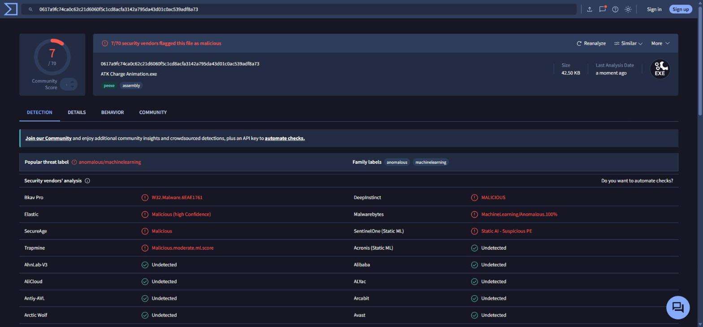

# VirusTotal raporu / report

| | |
|---|---|
| Dosya / File | `ATK Charge Animation.exe` (1.0.0.0, 43 520 bayt / bytes) |
| SHA-256 | `0617a9fc74ca0c62c21d6060f5c1cd8acfa3142a795da43d01c0ac539adf8a73` |
| Tarama / Scanned | 2026-10-14 11:28 UTC |
| Bağlantı / Link | https://www.virustotal.com/gui/file/0617a9fc74ca0c62c21d6060f5c1cd8acfa3142a795da43d01c0ac539adf8a73 |
| Sonuç / Result | **63 temiz / clean**, 7 yapay zekâ tabanlı tespit / AI-based detections, 4 desteklenmiyor / unsupported, 1 hata / failure |

## Türkçe

Microsoft Defender, Kaspersky, ESET, Bitdefender, Avast, AVG, Norton (Symantec), Sophos, Trend Micro, CrowdStrike, Fortinet, F-Secure, Avira, Dr.Web, Panda ve diğer 48 motor dosyayı **temiz** buldu.

Dosyayı işaretleyen 7 motorun (Elastic, Malwarebytes, SentinelOne, DeepInstinct, SecureAge APEX, Trapmine, Bkav) hepsi bilinen bir virüs imzası değil, **yapay zekâ / makine öğrenmesiyle dosyanın görünüşüne bakan** motorlardır; verdikleri adlar da bunu söyler: `MachineLearning/Anomalous`, `Static AI - Suspicious PE`, `ml.score`. VirusTotal'ın ortak etiketi de `anomalous/machinelearning`'dir.

Nedeni: `ATK Charge Animation.exe` küçük, dijital olarak imzasız ve içinde PowerShell betiklerini çalıştıran bir başlatıcıdır. Kötü amaçlı yazılımlar da bu yapıyı sık kullandığı için bu tür motorlar imzasız PowerShell başlatıcılarını sıklıkla yanlışlıkla işaretler. Başlatıcı yalnızca `app` klasöründeki betikleri çalıştırır; kaynak kodu [`app/tools/AtkLauncher.cs`](../tools/AtkLauncher.cs) dosyasındadır ve [`app/tools/build-launcher.ps1`](../tools/build-launcher.ps1) ile Windows'taki C# derleyicisiyle kendiniz derleyebilirsiniz. Programın tüm kodu bu repoda açıktır.

Bu rapor yalnızca yukarıdaki SHA-256'ya sahip sürüm içindir.

## English

Microsoft Defender, Kaspersky, ESET, Bitdefender, Avast, AVG, Norton (Symantec), Sophos, Trend Micro, CrowdStrike, Fortinet, F-Secure, Avira, Dr.Web, Panda and 48 other engines found the file **clean**.

All 7 engines that flagged it (Elastic, Malwarebytes, SentinelOne, DeepInstinct, SecureAge APEX, Trapmine, Bkav) are **AI / machine-learning engines judging the file's shape**, not signature matches; their labels say so: `MachineLearning/Anomalous`, `Static AI - Suspicious PE`, `ml.score`. VirusTotal's consensus label is `anomalous/machinelearning`.

Why: `ATK Charge Animation.exe` is a small, unsigned launcher that runs PowerShell scripts. Because malware often uses the same structure, such engines frequently flag unsigned PowerShell launchers. The launcher only runs the scripts in the `app` folder; its source is [`app/tools/AtkLauncher.cs`](../tools/AtkLauncher.cs) and you can build it yourself with [`app/tools/build-launcher.ps1`](../tools/build-launcher.ps1) using the C# compiler that ships with Windows. All of the program's code is in this repository.

This report applies only to the build with the SHA-256 above.

## Tüm sonuçlar / All results

| Motor / Engine | Sonuç / Result |
|---|---|
| APEX (SecureAge) | ⚠️ Malicious |
| Bkav | ⚠️ W32.Malware.6EAE1761 |
| DeepInstinct | ⚠️ MALICIOUS |
| Elastic | ⚠️ malicious (high confidence) |
| Malwarebytes | ⚠️ MachineLearning/Anomalous.100% |
| SentinelOne | ⚠️ Static AI - Suspicious PE |
| Trapmine | ⚠️ malicious.moderate.ml.score |
| Acronis | ✅ Undetected |
| AhnLab-V3 | ✅ Undetected |
| Alibaba | ✅ Undetected |
| alibabacloud | ✅ Undetected |
| ALYac | ✅ Undetected |
| Antiy-AVL | ✅ Undetected |
| Arcabit | ✅ Undetected |
| Avast | ✅ Undetected |
| AVG | ✅ Undetected |
| Avira | ✅ Undetected |
| BitDefender | ✅ Undetected |
| CAT-QuickHeal | ✅ Undetected |
| ClamAV | ✅ Undetected |
| CMC | ✅ Undetected |
| CrowdStrike | ✅ Undetected |
| CTX | ✅ Undetected |
| Cylance | ✅ Undetected |
| Cynet | ✅ Undetected |
| DrWeb | ✅ Undetected |
| Emsisoft | ✅ Undetected |
| ESET-NOD32 | ✅ Undetected |
| F-Secure | ✅ Undetected |
| Fortinet | ✅ Undetected |
| GData | ✅ Undetected |
| Gridinsoft | ✅ Undetected |
| huorong | ✅ Undetected |
| Ikarus | ✅ Undetected |
| Jiangmin | ✅ Undetected |
| K7AntiVirus | ✅ Undetected |
| K7GW | ✅ Undetected |
| Kaspersky | ✅ Undetected |
| Kingsoft | ✅ Undetected |
| Lionic | ✅ Undetected |
| MaxSecure | ✅ Undetected |
| McAfeeD | ✅ Undetected |
| Microsoft | ✅ Undetected |
| MicroWorld-eScan | ✅ Undetected |
| NANO-Antivirus | ✅ Undetected |
| Paloalto | ✅ Undetected |
| Panda | ✅ Undetected |
| Rising | ✅ Undetected |
| Sangfor | ✅ Undetected |
| Skyhigh | ✅ Undetected |
| Sophos | ✅ Undetected |
| SUPERAntiSpyware | ✅ Undetected |
| Symantec | ✅ Undetected |
| TACHYON | ✅ Undetected |
| tehtris | ✅ Undetected |
| Tencent | ✅ Undetected |
| TrellixENS | ✅ Undetected |
| TrendMicro | ✅ Undetected |
| TrendMicro-HouseCall | ✅ Undetected |
| Varist | ✅ Undetected |
| VBA32 | ✅ Undetected |
| VIPRE | ✅ Undetected |
| VirIT | ✅ Undetected |
| ViRobot | ✅ Undetected |
| Webroot | ✅ Undetected |
| Xcitium | ✅ Undetected |
| Yandex | ✅ Undetected |
| Zillya | ✅ Undetected |
| ZoneAlarm | ✅ Undetected |
| Zoner | ✅ Undetected |
| Avast-Mobile, BitDefenderFalx, SymantecMobileInsight, Trustlook | Desteklenmiyor (mobil) / Unsupported (mobile) |
| Google | Hata / Failure |
